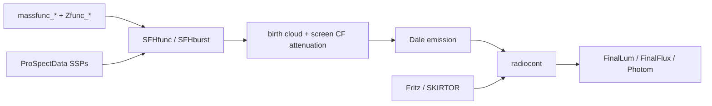

# ProSpect — agent notes

R package for generating and fitting galaxy spectral energy distributions (SEDs):
star formation histories (SFH) + metallicity histories → stellar spectra from SSP
libraries → dust attenuation/re-emission (Charlot & Fall + Dale 2014) → optional AGN
and radio continuum → photometry or spectra, generatively or inside a likelihood.

- Upstream: https://github.com/asgr/ProSpect (default branch `master`). Maintainer: Aaron Robotham.
- Dependencies that matter: **ProSpectData** (all the big SSP/dust/AGN templates; a hard
  `Depends`), **Rcpp** (C++ kernels), **ParmOff** (parameter mapping in the likelihood,
  GitHub-only, used via `ParmOff::`).
- 112 top-level functions in `R/` (~5.3k lines), 43 hand-written `man/*.Rd`, 8 vignettes,
  a testthat suite under `tests/testthat/`. No roxygen.

## Layout

| Path | Contents |
| --- | --- |
| `R/ProSpect.R` | `ProSpectSED()` (top-level model), `ProSpectSEDlike()` (likelihood) |
| `R/SFH.R` | `SFHfunc()`, `SFHburst()`, `SMstarfunc()` — spectra for a given mass/Z history |
| `R/massfuncs.R`, `R/Zfuncs.R` | SFH (`massfunc_*`) and metallicity-history (`Zfunc_*`) models |
| `R/dust.R`, `R/AGN.R`, `R/radiocont.R` | attenuation, Dale emission, Fritz/SKIRTOR AGN, radio |
| `R/photom.R`, `R/filters.R`, `R/specReBin.R` | magnitudes/fluxes, filter lookups, rebinning |
| `R/plots.R` | `plot.ProSpectSED`, `plot.ProSpectSEDlike` (S3, registered in NAMESPACE) |
| `R/utility.R`, `R/constants.R` | internal helpers, physical constants as `.name` objects |
| `src/*.cpp` | Rcpp kernels (`.disp_stars_cpp`, `.vec_add_cpp`, `.spec_rebin_cpp`, …) |
| `data/` | small stuff only: `filt_*.tab` filter curves, `pivwave`, `cenwave`, LKL10, AGN templates |
| `inst/*_app/app.R` | Shiny apps behind `runShinySED()` / `runShinyFilters()` |

Pipeline:



## Commands

```r
devtools::load_all()                     # normal iteration loop
devtools::load_all(); ProSpectSED(sparse = 10)   # fast smoke test (~0.5 s)
```

- There is **no** `devtools::document()` step. `man/*.Rd` is hand-maintained: when you
  change a signature you must edit the `\usage{}` and `\arguments{}` blocks yourself.
  Never run `roxygen2::roxygenise()` — it would wipe the `.Rd` files.
- C++ changed? `Rcpp::compileAttributes()` regenerates `R/RcppExports.R` and
  `src/RcppExports.cpp` (both committed, do not edit by hand), then reinstall.
- Tests: `testthat` (edition 3). `devtools::test()` or
  `Rscript -e 'testthat::test_local(".")'`; the whole suite takes ~10 s.
  `tests/testthat.R` calls `test_check("ProSpect")`, so `R CMD check` runs the
  installed build rather than `load_all()` output — reinstall after changing `R/`.
- Test layout: `helper-spectra.R` holds the fixtures (band list, filter list,
  cached `BC03lr`/`Dale_NormTot`, `.ps_photom()` / `.ps_sed()` wrappers). The
  bulk of the suite is `test-physics-trends.R`, which asserts that parameters move
  the SED in physically sensible *directions* (dust reddens and reradiates,
  metallicity reddens, mass scales linearly, …). The rest: `test-likelihood.R`
  (likelihood reproduces the generator exactly and is maximised at truth),
  `test-photoz.R` (photo-z mode and its cosmology resolution),
  `test-units-and-conversions.R`, `test-filters.R`, `test-filter-transform.R`,
  `test-zfuncs.R`, `test-rcpp-kernels.R`.
- Prefer direction/monotonicity assertions over hard-coded numbers: they survive
  SSP-library updates and pin down the physics rather than the arithmetic.
  Anything quantitative should be an exact invariant (energy conservation,
  round-trips, linearity).
- Full check (`devtools::check()` / CI) is slow and needs the GitHub-only Suggests
  (`cmaeshpc`, `Highlander`, `hyper.fit`, `ParmOff`, `ProFit`, `Rfits`), plus XQuartz on
  macOS. `.github/workflows/main.yml` runs `--as-cran` on 4 platform/R combinations.
- Quote a `Version:` bump in `DESCRIPTION` in the same commit as the behaviour change
  (the repo convention: 1.12.1 → 1.13.0 for a feature change).

## Conventions in this codebase

Follow the surrounding file rather than applying a global style.

- Assignment is overwhelmingly `=` (`f = function(x)`); `<-` appears only in
  `R/RcppExports.R` and in the copied-from-LaplacesDemon block in `R/utility.R`. Don't
  convert files to `<-`.
- 2-space indent, no tabs. Strings are usually single-quoted, though newer code in
  `R/ProSpect.R`/`R/dust.R` uses double quotes. Comments are sparse, `#note`-style, and
  usually explain a physics or performance decision, not the syntax.
- Internal names start with `.` (`.interval`, `.vec_add_cpp`, `.ff_frac_cal`).
  `NAMESPACE` uses `exportPattern("^[[:alpha:]]+")`, so **every letter-initial object is
  exported** and dot-prefixed ones stay private — name an internal helper `.foo` and it
  will not leak. New S3 methods need an explicit `S3method()` line.
- Missing optional packages are handled with `requireNamespace(..., quietly = TRUE)` and
  a `stop(...)`/fallback, not by importing them.
- `data()` is always called as `data('BC03lr', envir = environment())` inside the
  function — never attach data or assume objects exist in the global environment.
- Constants live in `R/constants.R` as `.c_to_mps`, `.lsol_to_erg`, etc. Reuse them
  instead of retyping numbers.

## Units (easy to get wrong)

| Quantity | Convention |
| --- | --- |
| Wavelength | Angstrom (Å). `FinalLum`/`FinalFlux` wave columns are Å. |
| `waveout` | **log10(Å)**, default `seq(2, 9.35, by = 0.01)`. Passed to `addspec()`, which does `10^waveout`. |
| Luminosity | `Lsun / Å`; `Photom` output is **Jansky** when `z > 0` and `filtout` is given, AB mag when `z <= 0`. |
| Ages inside R | years (`speclib$Age`, `agevec`). `magemax`/`agemax` arguments are Gyr at the `massfunc` boundary (`massfunc_const` multiplies by `1e9`). |
| Masses / SFR | `Msol`, `Msol/yr`; `magemax` in `massfunc_*` is Gyr. |
| Fitting | Always in flux (Jansky) space with `fluxerr`; never fit magnitudes. |

## Contracts worth knowing before editing

- **`massfunc(age, ...)`** must be vectorised: vector of ages in years in, SFR vector of
  the same length out, non-negative (a negative SFR is a hard `stop()` in `SFHfunc`).
- **`Zfunc(age, ..., massfunc, ...)`** returns a metallicity vector over the same ages;
  custom args are matched by binding against `formals(Z)` in `SFHfunc`.
- **`Zfunc_massmap_*` normalisation**: the total mass comes from a rectangle sum on
  the same 1e8-year grid the CDF is built on, *not* from `integrate()`. The two used to
  disagree by ~0.8% (masked by clipping the CDF at 0), and `integrate()` could miss a
  burst narrower than the grid and return 0 with `message = "OK"`, which silently
  flattened the whole Z history to `Zfinal`. Do not reintroduce `integrate()` here.
- **`filtout`** is a list of `approxfun()` objects over the filter curve
  (`list(approxfun(getfilt('r_VISTA')), ...)`), optionally named.
- **`ProSpectSED(...)`** silently clamps physical parameters with `.interval(x, lo, hi)`
  (e.g. `tau_birth` to `[0, 10]`, `pow_*` to `[-2, 0]`) instead of erroring; out-of-range
  input does not fail loudly.
- **`ProSpectSEDlike(parm, Data)`** is the likelihood passed to CMA/LD/Highlander. `Data`
  keys it reads: `flux`, `spec`, `photom`, `filtout`, `arglist`, `parm.names`, `logged`,
  `intervals`, `constraints`, `prior`, `fit`, `like`, `mode`, `mon.names`, `SFH`,
  `speclib`, `Dale`, `Dale_M2L_func`, `AGN`, `logbin`, `rough`, `verbose`. Return value
  depends on `Data$fit`: `-LP` (numeric) for `optim`/`cma`, a `list(LP, Dev, Monitor,
  yhat, parm)` for `ld`/`la`, and a classed `ProSpectSEDlike` object for `check` (which is
  what `plot.ProSpectSEDlike` consumes). All fitted parameters must be scalar.

## Common tasks

- **Add a filter**: drop `data/filt_<NAME>.tab` (two columns, `wave` in Å, `response`),
  add the name to `valid_filters` in `R/filters.R`, add any shorthand mapping below the
  registry in `getfilt()` (e.g. `Band1` → `Band1_ALMA`), add an `\alias{filt_<NAME>}` to
  `man/filters.Rd`, and add the pivot wavelength to `pivwave`/`cenwave` if it should
  appear under `filters = 'all'`.
- **Add a filter alias** (a rename, or a second capitalisation of an existing band): do
  *not* ship a duplicate `.tab` — map it to the canonical name in the alias block of
  `getfilt()` so the curves cannot drift apart. `g_Rubin` → `g_LSST` and `Y_LSST` →
  `y_LSST` are examples; `test-filters.R` asserts every registry name resolves.
- **Add an SFH model**: new `massfunc_*` in `R/massfuncs.R` (+ `man/` alias in
  `man/massfuncs.Rd` if that file covers it, otherwise a new `.Rd`), vectorised, honouring
  `magemax`.
- **Add a likelihood mode**: extend the `Data$like` branch at the bottom of
  `ProSpectSEDlike()` and keep the `return(-LP)` / list contract intact.
- **Add a C++ kernel**: put it in `src/`, export with a dot-prefixed name
  (`// [[Rcpp::export(".foo_cpp")]]`), run `Rcpp::compileAttributes()`, then use it from R.
  Add a case to `tests/testthat/test-rcpp-kernels.R` comparing against a plain-R
  reference implementation (tolerance ~1e-10), following `.disp_stars_cpp`.

## Known rough edges (verify before relying on these)

- mm/radio filters (ALMA, VLA, GMRT) and the Roman WFI filters are in `getfilt()` but not
  in `pivwave`/`cenwave`, so `filters = 'all'` never includes them.
- There are **two** Roman filter sets and they are not aliases: `*_WFIRST` (7 filters,
  HST-style names R062/Z087/Y106/J129/H158) and `*_WFI_ROMAN` (9 filters, F062…F213).
  Only `F184` and `W146` share a name. Use the WFI set for current work.
- `Stars$lumtot_atten` is the *absorbed* luminosity, not the transmitted one — it equals
  `lumtot_birth + lumtot_screen`. Use `.ps_integral(StarsAtten)` for transmission.
- `dustlum` is all zeros unless `Dale_M2L_func` is supplied; use `.ps_integral(DustEmit)`
  when you want the emitted luminosity without that function.
- `Dev` from `ProSpectSEDlike()` is -2 log L, not chi-squared, so it is not zero at a
  perfect fit.
- `.vec_add_cpp()` / `.vec_mult_cpp()` mutate their first argument **in place** and
  return `NULL`; they do not copy, so the caller's vector changes too.
- `$.vec_add_cpp`-style kernels: `.colSums_wt_cpp`, `.spec_rebin_cpp` etc. return bare
  numerics (not data frames), and `.spec_rebin_cpp` returns `c(flux, weight)` when
  `invar_in` is supplied.
- A non-scalar value in `Data$arglist` reaches `ProSpectSED` as a vectorised argument and
  fails inside the model rather than at a clean guard.

The above are encoded in `tests/testthat/`: most are pinned as documented-current
behaviour so that fixing one flips a red test rather than going unnoticed.

Doc/data consistency is also tested: `test-filters.R` asserts that every `filt_*` data
object has an `\alias{}` and that no alias points at a non-existent object. R CMD check
runs those tests from the *installed* package, so it reads `help/aliases.rds` rather than
parsing `man/*.Rd` (which is not shipped in the binary).

## Scope discipline

This is a physics package with many small, individually documented units. Prefer a
targeted change to one function plus its `.Rd` over refactoring shared helpers; the
numerics are validated by published model comparisons, and silently changing defaults
(`tau_birth`, `alpha_SF_*`, `sparse`, cosmology) invalidates existing fits.